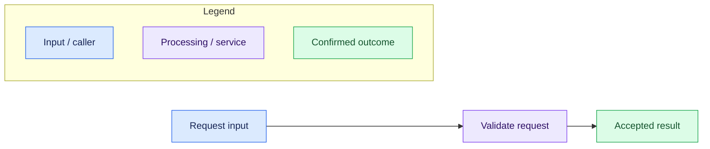

# Native Visualizer delivery

Shared delivery rules for visual and teach. Visual owns rendering; teach owns progressive explanation. Installed macOS bundle was verified as `~/Applications/Visualizer.app`, `CFBundleName=Visualizer`, version `0.1.0`; no `Visualization.app` was found. Recheck installed bundle before assuming its name has changed. Read this file fully before authoring visuals. Explicit invocation of these skills authorizes opening the installed local viewer for the requested document; no other app control, installation, agents or publication is authorized. Automatic teach selection should use text unless visualization was requested or opening the viewer was already approved.

## Files and authority

- Inspect real source and repository instructions. Keep facts, assumptions, proposals and unanswered questions distinct. Never include credentials or private runtime/session data.
- Use `~/.cache/agent-work/<repo>/<task>/<kind>.md` (visual or teach; choose descriptive document name for plans/recaps). Never write inside the repository.
- Write ordinary UTF-8 Markdown, at most 256 KiB. For polished diagrams, author local SVG alongside Markdown and embed as standalone `` paragraphs. Bounded local PNG screenshots are allowed using standard Markdown images; see PNG rules below. No MDX, JSX, HTML, custom schema or remote images. No package downloads, servers, browser, hosted preview or Claude child session.
- Canonical decisions remain in repository `spec.md` where applicable. Derived documents identify canonical/source paths and inspected revision or uncommitted state as plain text. Update canonical spec first after approved decision changes, then refresh derived document. Do not invent a canonical spec requirement for ordinary teaching or routine work.
- Never overwrite unrelated documents. Keep same artifact path during requested revisions so selected file reloads. Feedback and approvals stay in chat; viewer is read-only.

## Readable content

Start with short purpose and key conclusion. Mix concise prose, small tables and diagrams; no mandatory section or diagram quota. Use one synthetic example consistently for teaching. Include prose equivalent beside each diagram so omissions remain understandable.

Use conservative Mermaid flowcharts (`flowchart TD` or `flowchart LR`) and simple `sequenceDiagram` blocks. Prefer short quoted labels, basic nodes and edges. Split crowded diagrams into small phase views. Avoid browser-specific Mermaid directives, icons, click callbacks, HTML labels or styling-dependent meaning. Rune supports a subset and may silently omit statements: parser success does not prove complete rendering. Unknown/unsupported diagrams should become prose/table, not a custom renderer. Inspect Source in viewer when uncertain; do not promise full Mermaid support, clickable links, arbitrary image formats, interactive decision forms or semantic node actions.

## Local PNG screenshots and galleries

Use standalone `` image blocks. Consecutive image blocks form a gallery; headings or prose separate groups (blank lines alone do not). Expanded images expose Previous/Next, position/caption, Left/Right, Zoom/Fit/Back/Escape. Navigation stops at ends and resets zoom/pan. Keep prose equivalents and original evidence verdicts; screenshots do not prove untested behavior.

PNG files must remain under selected Markdown directory or descendants. Lowercase `.png` relative paths only; no traversal, absolute paths, symlinks, URL/percent/query/fragment syntax. At most 16 unique PNGs, 8 MiB each, 32 MiB total PNG source. Dimensions 1–4096 per axis, at most 8,388,608 pixels each and 33,554,432 PNG pixels/document. SVG keeps separate limits below. Invalid/missing assets retain previous accepted content with error; verify fresh rendering rather than stale retained images. No remote fetching or private runtime/auth/session screenshots. App installation still requires explicit approval.

## Authored SVG preferred for polished diagrams

Prefer SVG for requested beautiful diagrams or precise layout, fills and embedded legend. Mermaid remains suitable for small quick sketches. Markdown owns prose; SVG owns authored diagram geometry. Installed app supports a bounded native SVG subset, not browser SVG.

Inspect an existing local app example such as `app/examples/booking.svg` and companion `booking.md` in a known viewer source checkout when available; do not copy domain claims into unrelated diagrams. Use compact phase cards or lanes, clear hierarchy, short labels, generous whitespace and 2–4 consistent semantic colors. Explicit Helvetica/sans-serif text, explicit text/fill/stroke colors, fixed light or dark canvas background, readable contrast. Plan geometry so arrows connect correct steps without crossing labels. Open connector paths must set `fill="none"`. Put compact labeled color swatches inside SVG canvas as embedded legend, outside actual process. Include `<title>`/`<desc>`, meaningful Markdown alt text and concise prose equivalent. Split dense diagrams instead of shrinking text.

Keep SVG beside Markdown or in descendant folder; relative `.svg` filenames only. No traversal, absolute paths, symlinks, URL/percent/query/fragment syntax. Limits: 8 assets, 512 KiB each, 2 MiB total; dimensions 1–4096, prefer ~1120×680. Rendering rasterizes up to 2x capped 2048 pixels per axis; not infinite-resolution zoom.

Allowed elements: `svg`, `g`, `defs`, `rect`, `circle`, `ellipse`, `line`, `polyline`, `polygon`, `path`, `text`, `tspan`, `title`, `desc`, `marker`, `linearGradient`, `radialGradient`, `stop`. Use explicit presentation attributes; no `style`, CSS/classes, scripts, images, foreignObject, href/use, animation or external resources. Namespace must be `http://www.w3.org/2000/svg`. Markers: one simple child `path`, at most 256 path-data bytes; marker-start/end only on main drawing path/line/polyline/polygon, never within markers or inherited on groups. No marker-mid. Use local `url(#id)` for arrowheads/gradients only. Explicit `tspan` positions for wrapped text. Do not claim arbitrary SVG compatibility.

Check visual layout, labels, connectors and embedded legend in viewer when possible. Existing selected Markdown reloads when SVG changes; invalid SVG retains prior accepted view and reports error. Fix asset, do not mistake stale retained diagram for updated success.

## Diagram colors by default

For visual and teach, add restrained semantic colors to Mermaid flowcharts by default, unless user requests monochrome. Use 2–4 roles per diagram and keep meanings consistent across related diagrams. Colors indicate roles or states, not decoration; never imply an unverified success, failure or trust boundary. Every colored flowchart includes a compact legend inside the diagram: a disconnected `subgraph legend ["Legend"]` containing one short labeled node per color role actually used. Apply the same classes to legend nodes; no legend edges, invented states or unused palette entries. Use unique IDs such as `legend_input` to avoid collisions with real nodes. Keep legend visually separate from actual process so it cannot imply execution steps. Also include a short prose legend below diagram for accessibility and renderer fallback. Labels and prose must carry the same information without color.

Prefer explicit `classDef` plus `class` using six-digit hex `fill`, `stroke` and `color`. Set text color with each fill; do not rely on inherited dark/light text. Reuse this small high-contrast palette as applicable:

| Role | Fill | Stroke | Text |
| --- | --- | --- | --- |
| Input / caller | #dbeafe | #2563eb | #172554 |
| Processing / service | #ede9fe | #7c3aed | #2e1065 |
| Confirmed outcome | #dcfce7 | #16a34a | #14532d |
| Decision / caution | #fef3c7 | #d97706 | #451a03 |
| Failure / rejected path | #fee2e2 | #dc2626 | #450a0a |

Choose only relevant roles, not every palette entry. Example:



Legend: blue = input/caller; purple = processing/service; green = confirmed outcome.

Use direct `style A fill:...,stroke:...,color:...` for isolated exceptions. Optional `linkStyle 0 stroke:#2563eb,stroke-width:2px` colors a known edge; indices are zero-based and must be checked again after adding/reordering edges. Keep default edges when color adds no meaning. Do not inject flowchart styles into sequence diagrams or other diagram families: retain their native theme unless exact syntax is verified for pinned Rune. Never insert flowchart legend nodes into sequence diagrams; explain any verified color meaning in adjacent prose instead. No CSS, theme/init directives or custom renderer needed. Inspect actual colors and label contrast in light/dark views when rendering evidence is available; otherwise report visual validation unrun. Unsupported style may be silently omitted.

## Open and verify

Check installed app exists at `$HOME/Applications/Visualizer.app`. After writing requested artifact, resolve absolute file path and run with quoted paths:

```sh
open -n -a "$HOME/Applications/Visualizer.app" --args "/absolute/path/to/document.md"
```

Current app lacks macOS document-open event handling: `open -a APP FILE` fails. Use above CLI-argument workaround for first opening; it starts new instance. Do not change default associations or reinstall. A successful `open` proves dispatch only, not rendering or file selection. If document does not appear, ask user to use Open / Cmd+O to select that exact path; report gap. Viewer reloads only currently selected file. If app missing or launch fails, retain Markdown/text and report blocker; do not substitute another renderer or install silently.

Return artifact path, concise text equivalent and actual checks. Native visual confirmation and headless rendering evidence must stay distinct. No claim of complete diagram rendering without inspection. Do not open repeatedly on each revision when file already selected.
